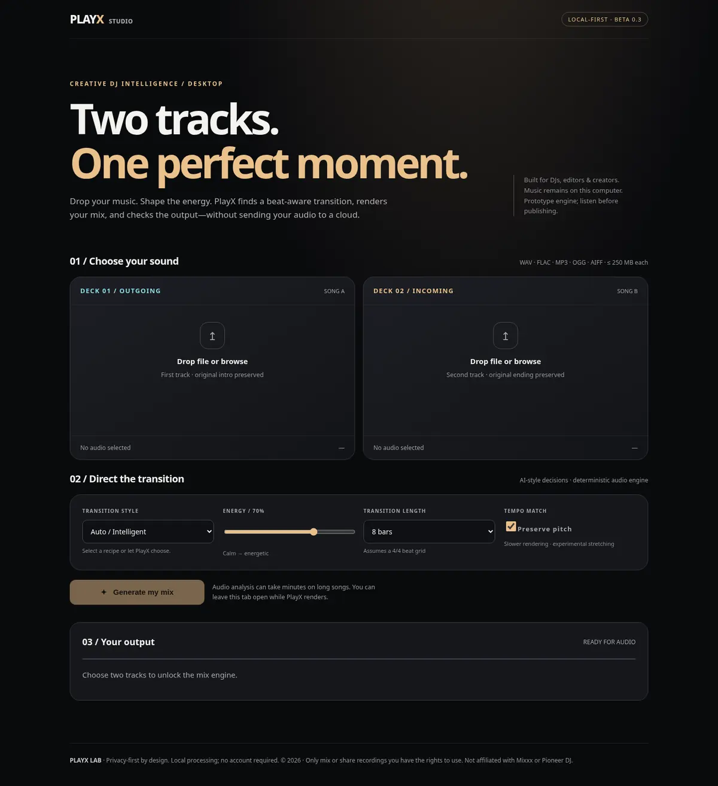

# PlayX Studio

**Create better DJ transitions without surrendering creative control.**

[](https://github.com/agentthom1-a11y/playx/actions/workflows/ci.yml)

**v0.3.0b1 · public-beta candidate · local-first, open-source (MIT).** For creators, beginner DJs, remix editors, and producers. PlayX turns two authorized recordings into a beat-aware 24-bit WAV mix and a technical quality report. No account or subscription, and your audio is not sent to a remote server.



> **This is an engineering beta, NOT commercial production certification.** Real Mixxx compatibility, batch mastering, audio perceptual quality, code signing, Windows installer behavior and copyright clearances require further testing before large-scale launch.

## Get started on Windows

Install Python 3.11+, clone the repository and double-click **`start-playx.cmd`**. Or use CMD:

```bat
git clone https://github.com/agentthom1-a11y/playx.git
cd playx
py -3.11 -m venv .venv
.venv\Scripts\python.exe -m pip install -e ".[full]"
.venv\Scripts\playx.exe studio
```

Open **http://127.0.0.1:8765**. Drop files into deck A and B, select energy and transition style, render in a background job, then play/download your mix and quality report. Supported files depend on libsndfile codecs; WAV and FLAC are the most reliable. **Tracks: 2 seconds–12 minutes, at most 250 MiB per file.** Free disk space matters: each export is uncompressed 24-bit WAV.

**Experimental portable build:** GitHub Actions → [Windows portable beta package](.github/workflows/windows-portable.yml) → Run workflow → download artifact. This build is **unsigned**, untested on representative customer machines, and should not be marketed as a trusted installer yet.

## PlayX features

- **Studio:** responsive dark UI with upload/drop-zone, waveform preview, render jobs, local player, downloadable WAV/JSON.
- **Analysis:** estimated BPM, beat positions, musical key, approximate RMS energy.
- **Mix engine:** phrase-aware transition planning, five recipes (smooth, bass swap, filter sweep, echo out, drop swap), optional pitch-preserving time stretch and safer output peaks.
- **Technical QA:** WAV sample-peak, RMS, quiet sections, transition seam discontinuity; streamed inspection to avoid full-file allocation.
- **Set planning:** recommend a 2–30 track running order using BPM/key/energy compatibility; does *not* perform a live DJ set.
- **Experimental setmix:** offline concatenate 2–6 user-supplied tracks with transitions. Multi-pass quality is not the same as a mastered one-pass render.
- **Experimental live Mixxx bridge:** crossfader, highlighted track loading, active beat feedback via virtual MIDI. Requires manual controller mapping and rehearsal; no guaranteed phrase/downbeat alignment.
- **Optional Claude planner:** requires your own Anthropic API credentials. Only selected **track metadata** is sent to the API; audio remains local. The online AI step is never required to render audio.

## CLI

```bat
playx doctor
playx analyze "C:\Music\one.wav"
playx plan "C:\Music\one.wav" "C:\Music\two.wav" --out plan.json
playx mix "C:\Music\one.wav" "C:\Music\two.wav" --style bass_swap --bars 8 --out mix.wav
playx quality mix.wav --out qa.json
playx setlist "C:\Music" --limit 8 --profile build --out setlist.json
playx setmix "C:\Music\one.wav" "C:\Music\two.wav" "C:\Music\three.wav" --out dj-set.wav
playx mixxx-ports
playx mixxx-status --port "PlayX"
```

**Do not reuse an existing output filename:** PlayX refuses accidental overwrites; choose a new path. The browser studio handles export naming automatically.

## Architecture

```text
Browser (localhost:8765)
  ├─ file upload (size/type/time validation) → local PlayX workspace
  ├─ job queue (one renderer worker, bounded queue)
  └─ job/status → local WAV / technical QA JSON
            ↓
Audio analyzer (librosa) → explainable transition planner → deterministic renderer
            ↓
       Mixxx MIDI bridge (optional, separate from offline export)
```

The default local workspace is **`~/PlayX`** (`%USERPROFILE%\PlayX` on Windows). Override it with `PLAYX_DATA_DIR`. The Studio binds only to loopback and checks request Host/Origin headers. It has **no remote account system or multi-user authentication**: **do not expose the server to the public Internet.** Render jobs are sequential and their exports remain on disk across restarts; interrupted jobs need resubmission. Back up or clear the workspace manually to reclaim space.

## Commercial safety & rights

PlayX is MIT licensed. **Mixxx is independently installed** and published under **GPL v2 or later**; PlayX does not bundle Mixxx source or binary. Before redistributing combined applications, get appropriate license review. Users are responsible for securing rights to use, remix, perform or distribute audio. No copyrighted music or samples are bundled. See [Privacy & safety](docs/PRIVACY.md), [release gates](docs/RELEASE_CHECKLIST.md), [product strategy](docs/PRODUCT.md) and [Mixxx setup](docs/MIXXX.md).

## Developer validation

```bat
python -m pip install -e ".[dev]"
python -m pytest -q
python -m pip wheel --no-deps --no-build-isolation -w dist .
```

Tests cover rendering, quality reports, localhost security policy, file upload, job completion, downloads, setmix and MIDI simulation. They **do not** prove compatibility with every audio format, Windows driver, real Mixxx beat feedback, consumer machines, or large concurrent workloads.

## Attribution

Architecture informed by [Mixxx MIDI scripting](https://github.com/mixxxdj/mixxx/wiki/midi-scripting) and [DJ_SERENA](https://github.com/serenakeyitan/DJ_SERENA). No DJ_SERENA source or Mixxx binary is redistributed. MIT license in [LICENSE](LICENSE).
